# Lab 13 - BGP Communities + Local Preference (6 Routers)

**CCNP ENCOR Domain:** 3.0 Infrastructure (25%)
**Topics:** BGP Communities, Local Preference, Route-Maps, Community-Lists, Path Selection, send-community

---

## Topology

```
           R5 (AS 500) - Community Source
          /            \
    e0/1(10.1.5.1)   e0/0(10.4.5.4)
         |                |
    e0/1(10.1.5.5)   e0/1(10.4.5.5)
   R1 (AS 100) ------  R4 (AS 400)
   e0/2(10.14.0.1)   e0/2(10.14.0.4)
      |                    |
   e0/0(10.1.2.1)     e0/0(10.3.4.4)
      |                    |
   e0/0(10.1.2.2)     e0/1(10.3.4.3)
   R2 (AS 200)        R3 (AS 300)
   e0/1(10.2.6.2)     e0/0(10.3.6.3)
         \            /
    e0/0(10.2.6.6)  e0/1(10.3.6.6)
          R6 (AS 600)

   Ring path:  R1 - R2 - R6 - R3 - R4 - R5 - R1
   Direct:     R1 - R4 (cross-link for dual-path selection)

   R5 tags prefixes with communities:
     Community 1:1 -> 5.5.5.10, 5.5.6.10
     Community 2:2 -> 5.5.7.10, 5.5.8.10

   R1 and R4 use local-preference to select paths based on community.
```

## EVE-NG Topology

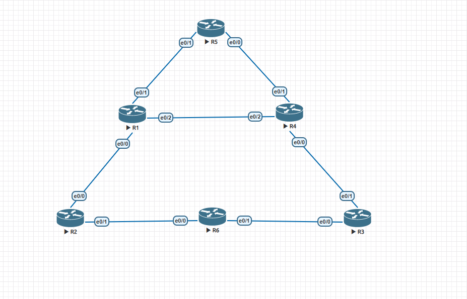

---

## Objectives

1. Tag BGP prefixes with communities on R5 using access-lists and route-maps
2. Propagate communities across multiple eBGP hops with send-community both
3. Match communities on R1 and R4 using ip community-list
4. Apply local-preference via inbound route-maps to influence path selection
5. Verify that R1 and R4 each see multiple paths and select the correct best path per community
6. Understand why a ring topology alone cannot provide two usable paths (BGP best-path-only advertisement)

---

## Router Table

| Router | AS | Role | Interfaces | Notes |
|--------|------|------|------------|-------|
| R1 | 100 | Path Selector | e0/0 (10.1.2.1), e0/1 (10.1.5.1), e0/2 (10.14.0.1) | Local-pref based on community |
| R2 | 200 | Transit | e0/0 (10.1.2.2), e0/1 (10.2.6.2) | Ring path R1-side |
| R3 | 300 | Transit | e0/0 (10.3.6.3), e0/1 (10.3.4.3) | Ring path R4-side |
| R4 | 400 | Path Selector | e0/0 (10.3.4.4), e0/1 (10.4.5.4), e0/2 (10.14.0.4) | Local-pref based on community |
| R5 | 500 | Community Source | e0/0 (10.4.5.5), e0/1 (10.1.5.5), Lo100-103 | Tags prefixes with 1:1 and 2:2 |
| R6 | 600 | Transit | e0/0 (10.2.6.6), e0/1 (10.3.6.6) | Ring middle hop |

---

## Config Highlights

### Community Tagging on R5

R5 uses access-lists to group prefixes and a route-map to stamp communities during redistribution:

```
access-list 10 permit 5.5.5.0 0.0.0.255
access-list 10 permit 5.5.6.0 0.0.0.255
access-list 20 permit 5.5.7.0 0.0.0.255
access-list 20 permit 5.5.8.0 0.0.0.255

route-map lab-community permit 10
 match ip address 10
 set community 1:1

route-map lab-community permit 20
 match ip address 20
 set community 2:2

router bgp 500
 redistribute connected route-map lab-community
```

### Community Propagation

Every router in the path must have `send-community both` for each neighbor, otherwise communities are stripped at each hop:

```
neighbor 10.1.5.5 send-community both
```

### Local Preference on R1

R1 matches communities with ip community-list and sets local-preference via inbound route-maps:

```
ip community-list 1 permit 1:1
ip community-list 2 permit 2:2

route-map From-R5 permit 10
 match community 1
 set local-preference 50
route-map From-R5 permit 20
 match community 2
 set local-preference 200
route-map From-R5 permit 30

route-map From-R4 permit 10
 match community 1
 set local-preference 200
route-map From-R4 permit 20
 match community 2
 set local-preference 50
route-map From-R4 permit 30
```

Result: Community 1:1 prefers R4 path (LocPrf 200), community 2:2 prefers R5 direct (LocPrf 200).

### Local Preference on R4

Mirror logic - community 1:1 prefers R5 direct, community 2:2 prefers R1 path:

```
route-map From-R5 permit 10
 match community 1
 set local-preference 200
route-map From-R5 permit 20
 match community 2
 set local-preference 50
route-map From-R5 permit 30

route-map From-R1 permit 10
 match community 1
 set local-preference 50
route-map From-R1 permit 20
 match community 2
 set local-preference 200
route-map From-R1 permit 30
```

### Catch-All Sequence

Every route-map ends with an empty permit (sequence 30) to allow routes that do not match any community. Without this, unmatched routes are implicitly denied.

---

## Verification Commands

### 1. Verify communities are tagged on R5

```
R5# show ip bgp
```
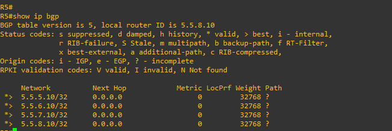

Expected: Each prefix shows its community (1:1 or 2:2) in the route details.

### 2. Verify communities arrive at R1

```
R1# show ip bgp community 1:1
R1# show ip bgp community 2:2
```
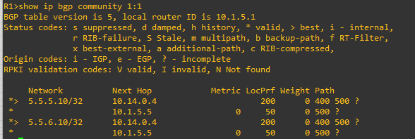

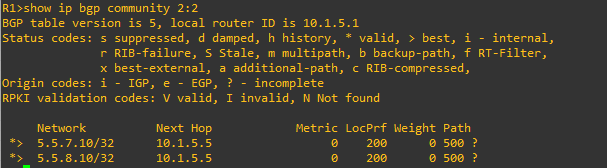

Expected: 1:1 shows 5.5.5.10 and 5.5.6.10. 2:2 shows 5.5.7.10 and 5.5.8.10.

### 3. Verify path selection on R1

```
R1# show ip bgp
```
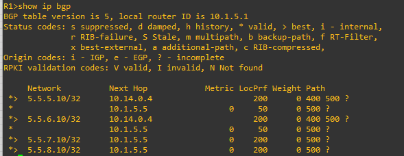

Expected:
- 5.5.5.10, 5.5.6.10 (1:1): best via R4 (10.14.0.4), LocPrf 200
- 5.5.7.10, 5.5.8.10 (2:2): best via R5 (10.1.5.5), LocPrf 200
- Third path via R2 ring visible but not selected

### 4. Verify path selection on R4

```
R4# show ip bgp
```
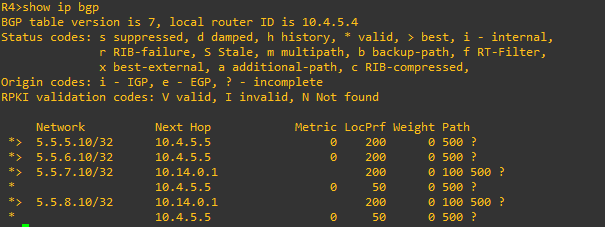


Expected:
- 5.5.5.10, 5.5.6.10 (1:1): best via R5 (10.4.5.5), LocPrf 200
- 5.5.7.10, 5.5.8.10 (2:2): best via R1 (10.14.0.1), LocPrf 200

### 5. Verify detailed path info

```
R1# show ip bgp 5.5.5.10
R4# show ip bgp 5.5.7.10
```
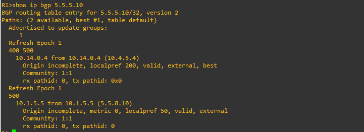

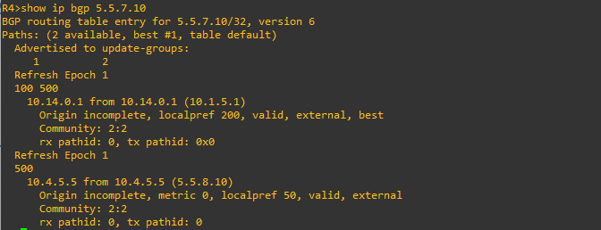

Expected: Shows community string, local-preference value, and full AS-PATH for each path.

### 6. Verify all BGP sessions

```
R1# show ip bgp summary
R4# show ip bgp summary
R6# show ip bgp summary
```
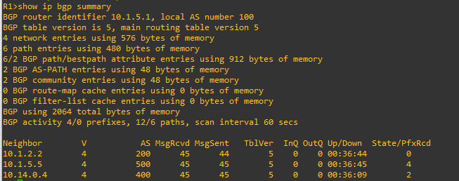

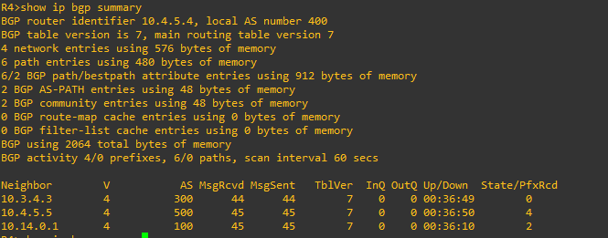

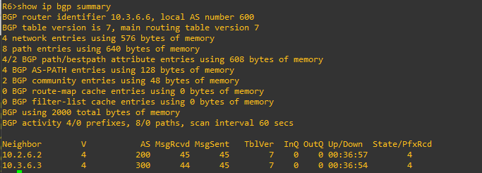

Expected: All neighbors in Established state with prefixes received.

### 7. Verify community propagation across the ring

```
R2# show ip bgp 5.5.5.10
```
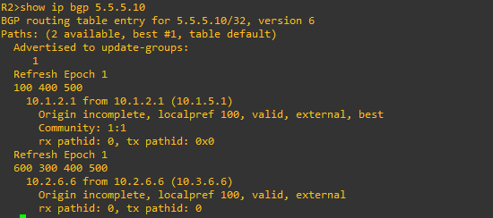

Expected: Community 1:1 visible in route details, confirming send-community both is working across multiple hops.

---

## Troubleshooting - Bugs Found and Fixed

### Bug 1: R4 missing "set" keyword in route-map

**Symptom:** Local-preference not applied on R4 for routes from R5

**Root Cause:** Route-map From-R5 had `local-preference 200` instead of `set local-preference 200`. IOS rejects the command silently without the `set` keyword.

**Fix:** Added `set` keyword: `set local-preference 200` and `set local-preference 50`.

### Bug 2: R5 neighbor pointed to its own IP

**Symptom:** R5 could not establish BGP session with R1

**Root Cause:** R5 had `neighbor 10.1.5.5 remote-as 100` - 10.1.5.5 is R5's own interface, not R1's.

**Fix:** Changed to `neighbor 10.1.5.1 remote-as 100`.

### Bug 3: R4 had wrong remote-as for R3

**Symptom:** R4-R3 session stuck in Active, "peer in wrong AS" notification

**Root Cause:** R4 had `neighbor 10.3.4.3 remote-as 200` but R3 was changed to AS 300.

**Fix:** Changed to `neighbor 10.3.4.3 remote-as 300`.

### Bug 4: Ring topology could not deliver second path

**Symptom:** R1 and R4 each saw only one path despite 6-router ring

**Root Cause:** BGP advertises only the best path. In the ring, intermediate routers (R2, R3) received a shorter path from the near-side neighbor (R1, R4) than the ring path, so they never forwarded the ring path onward. The eBGP-learned shorter path always beat the longer ring path.

**Fix:** Added a direct R1-R4 eBGP link (e0/2 on both). R1 now receives paths from R5 (direct) and R4 (direct). R4 receives from R5 (direct) and R1 (direct). The ring path still arrives at R1 via R2 as a third option.

### Bug 5: IOUweb cable mapping issues

**Symptom:** R1-R5 link showed up/up but ping failed, CDP showed no neighbor

**Root Cause:** IOUweb had a cable mapping bug where physical connectivity was not actually established despite correct IP configuration.

**Fix:** Migrated topology to EVE-NG where cable mapping worked correctly.

---

## Key Concepts

### BGP Communities
Communities are 32-bit tags (displayed as AS:Value in new-format) attached to BGP routes. They allow scalable policy - tag once at the source, match and act anywhere in the network. Without communities, every router would need per-prefix access-lists.

### Local Preference
Local preference is a BGP attribute used within an AS (or between eBGP peers via route-maps) to influence outbound path selection. Higher local-preference wins. Default is 100. It is applied on the receiving router via inbound route-maps, not on the sender.

### send-community both
By default, BGP strips communities when advertising to eBGP peers. The `send-community both` command preserves both standard and extended communities across eBGP hops. Every router in the chain must have this configured.

### Route-Map Catch-All
A route-map without a final empty permit sequence implicitly denies all unmatched routes. The empty `permit 30` ensures routes without communities (or with other communities) are still accepted.

### ip community-list vs access-list
Community-lists match BGP community values (1:1, 2:2). Access-lists match IP prefixes. They serve different purposes: community-lists for policy matching, access-lists for prefix matching. R5 uses access-lists to identify which prefixes to tag, R1/R4 use community-lists to match the tags.

---

## Design Decisions

- **Direct R1-R4 link** - A ring topology alone cannot deliver two usable paths because BGP only advertises the best path and shorter paths always win at intermediate routers. The direct cross-link gives R1 and R4 two independent eBGP paths.
- **All eBGP (no iBGP in the ring)** - R2, R3, R6 are each in separate ASes. This avoids the iBGP next-hop-self problem and ensures communities propagate without additional configuration.
- **Community tagging at the source** - R5 is the only router that tags communities. All other routers just propagate and match them. This is the scalable real-world pattern.
- **Symmetric local-pref design** - R1 and R4 apply opposite preferences for the same communities, splitting traffic across both direct paths.

---

## ENCOR Exam Relevance

| Topic | ENCOR Weight | What This Lab Covers |
|-------|-------------|---------------------|
| BGP communities | 3.0 Infrastructure | Tagging with route-maps, matching with community-lists |
| Local preference | 3.0 Infrastructure | Inbound route-maps, higher wins, path selection |
| BGP path selection | 3.0 Infrastructure | Local-pref beats AS-PATH length in decision process |
| Route-maps | 3.0 Infrastructure | match/set logic, sequence numbering, implicit deny |
| send-community | 3.0 Infrastructure | Required for community propagation across eBGP |
| BGP best-path advertisement | 3.0 Infrastructure | Only best path advertised - ring topology limitation |

---

## Files

```
lab-13-bgp-community-local-pref/
  README.md
  configs/
    R1.txt
    R2.txt
    R3.txt
    R4.txt
    R5.txt
    R6.txt
```
