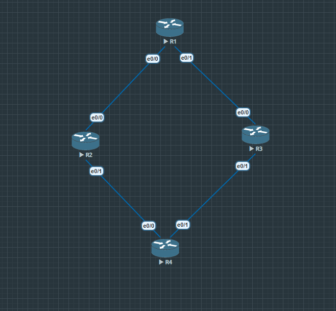
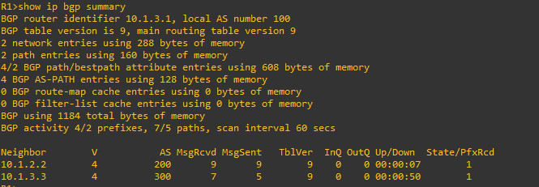
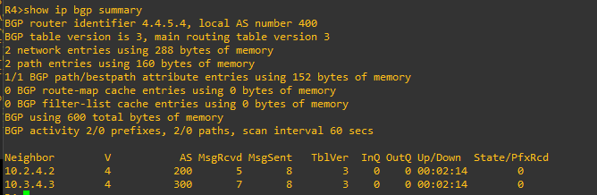
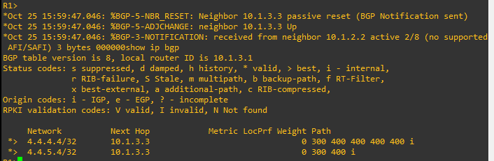
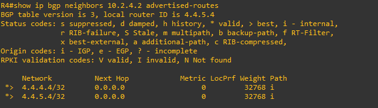
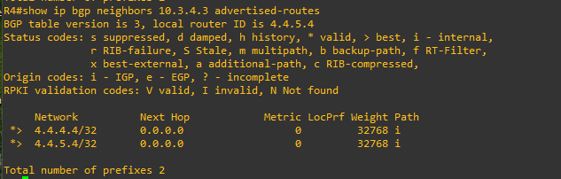
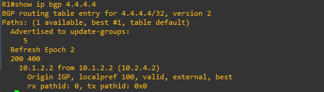
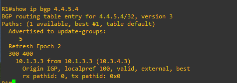
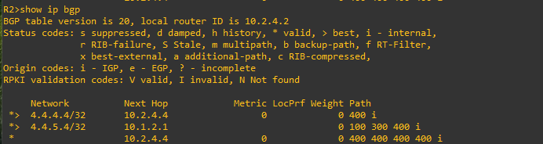
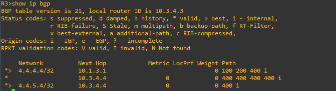

# Lab 14 - BGP AS-PATH Prepend (4 Routers)

**CCNP ENCOR Domain:** 3.0 Infrastructure (25%)
**Topics:** AS-PATH Prepend, Outbound Route-Maps, Selective Path Manipulation, BGP Best-Path Selection

---

## Topology

```
        R1 (AS 100) - Observer / Customer
       /             \
  e0/0(10.1.2.1)   e0/1(10.1.3.1)
      |                |
  e0/0(10.1.2.2)   e0/0(10.1.3.3)
      |                |
   R2 (AS 200)     R3 (AS 300)
   ISP-A            ISP-B
      |                |
  e0/1(10.2.4.2)   e0/1(10.3.4.3)
      |                |
  e0/0(10.2.4.4)   e0/1(10.3.4.4)
        R4 (AS 400) - Dual-homed, prepends here
        Lo10: 4.4.4.4/32 (YouTube / Web traffic)
        Lo20: 4.4.5.4/32 (Gaming traffic)

   R4 uses selective AS-PATH prepend to steer inbound traffic:
     YouTube (4.4.4.4) -> arrives via R2 (ISP-A)
     Gaming  (4.4.5.4) -> arrives via R3 (ISP-B)
```
## EVE NG Topology


---

## Objectives

1. Configure a dual-homed AS (R4) with two upstream ISPs (R2 and R3)
2. Use AS-PATH prepend to influence inbound path selection per prefix
3. Apply outbound route-maps with access-lists for selective prepending
4. Verify that R1 selects different best paths per prefix based on AS-PATH length
5. Understand the relationship: inbound traffic control = outbound route manipulation

---

## Router Table

| Router | AS | Role | Interfaces | Notes |
|--------|------|------|------------|-------|
| R1 | 100 | Observer / Customer | e0/0 (10.1.2.1), e0/1 (10.1.3.1) | Sees both paths, picks shorter AS-PATH |
| R2 | 200 | ISP-A (Transit) | e0/0 (10.1.2.2), e0/1 (10.2.4.2) | Carries YouTube traffic |
| R3 | 300 | ISP-B (Transit) | e0/0 (10.1.3.3), e0/1 (10.3.4.3) | Carries Gaming traffic |
| R4 | 400 | Dual-homed Source | e0/0 (10.2.4.4), e0/1 (10.3.4.4), Lo10, Lo20 | Prepends selectively per prefix |

---

## Config Highlights

### Selective Prepend on R4

R4 uses two outbound route-maps - one per ISP neighbor. Each prepends R4's own AS (400) three times on the prefix that should NOT use that ISP, making the path look longer:

```
access-list 10 permit 4.4.4.0 0.0.0.255   ! YouTube prefix
access-list 20 permit 4.4.5.0 0.0.0.255   ! Gaming prefix

! Toward R2 (ISP-A): prepend Gaming prefix so R1 avoids R2 for gaming
route-map Traffic-Web-R2 permit 10
 match ip address 20
 set as-path prepend 400 400 400
route-map Traffic-Web-R2 permit 20

! Toward R3 (ISP-B): prepend YouTube prefix so R1 avoids R3 for YouTube
route-map Traffic-Game-R3 permit 10
 match ip address 10
 set as-path prepend 400 400 400
route-map Traffic-Game-R3 permit 20

router bgp 400
 neighbor 10.2.4.2 route-map Traffic-Web-R2 out
 neighbor 10.3.4.3 route-map Traffic-Game-R3 out
```

### Why Outbound Route-Maps?

AS-PATH prepend controls **inbound** traffic by manipulating **outbound** advertisements. R4 cannot reach into R1 and change R1's decision. But R4 CAN make one path look longer by padding the AS-PATH, so R1 naturally picks the shorter alternative.

Think of it like highway signs - you can't control which road cars take to your house, but you can put up "road construction, 3 hour delay" signs on one road so cars take the other.

### Catch-All Sequence

Each route-map ends with an empty permit (sequence 20). Without this, the non-matching prefix would be implicitly denied and never advertised to that ISP at all.

---

## Verification Commands

### 1. Verify BGP sessions are established

```
R1# show ip bgp summary
R4# show ip bgp summary
```




Expected: All neighbors in Established state.

### 2. Verify path selection on R1

```
R1# show ip bgp
```


Expected:
- 4.4.4.4/32 (YouTube): best via R2, AS-PATH `200 400`
- 4.4.5.4/32 (Gaming): best via R3, AS-PATH `300 400`

### 3. Verify prepend is applied on R4

```
R4# show ip bgp neighbors 10.2.4.2 advertised-routes
R4# show ip bgp neighbors 10.3.4.3 advertised-routes
```



Expected:
- Toward R2: 4.4.5.4 shows AS-PATH `400 400 400 400` (prepended), 4.4.4.4 shows `400` (clean)
- Toward R3: 4.4.4.4 shows AS-PATH `400 400 400 400` (prepended), 4.4.5.4 shows `400` (clean)

### 4. Verify detailed path on R1

```
R1# show ip bgp 4.4.4.4
R1# show ip bgp 4.4.5.4
```



Expected: Each shows the selected best path. The second path via the prepended ISP may not appear due to BGP best-path-only convergence (see Design Decisions below).

### 5. Verify on transit routers

```
R2# show ip bgp
R3# show ip bgp
```




Expected: R2 and R3 each see R4's prefixes with the prepended or clean AS-PATH depending on R4's outbound route-map for that neighbor.

---

## Troubleshooting - Bugs Found and Fixed

### Bug 1: Prepending wrong AS number

**Symptom:** R1 completely lost routes instead of seeing a longer path

**Root Cause:** Initial config had `set as-path prepend 100 100 100` (R1's AS). When R1 saw its own AS in the path, BGP loop prevention kicked in and R1 rejected the route entirely.

**Fix:** Always prepend your own AS: `set as-path prepend 400 400 400`. This is a fundamental rule - you can only prepend your own AS number.

### Bug 2: Route-map sequence numbers reversed

**Symptom:** Prepend not applied - all prefixes passed through without modification

**Root Cause:** The match/set sequence was numbered higher than the catch-all:
```
route-map Traffic-Game-R3 permit 20   ! match + prepend
route-map Traffic-Game-R3 permit 10   ! empty catch-all
```
IOS evaluates sequences in numerical order. Sequence 10 (empty permit) ran first, matched everything, and permitted all routes without prepending. Sequence 20 was never reached.

**Fix:** Put the specific match first (sequence 10) and catch-all last (sequence 20).

### Bug 3: Second path disappears after convergence

**Symptom:** R1 initially saw two paths per prefix, then one path disappeared

**Root Cause:** This is expected BGP behavior in a diamond topology. After R1 picks a best path, it re-advertises that path to the other transit router. The transit router then has a shorter path via R1 than the prepended path from R4, so it switches its best to R1's path and withdraws its own advertisement to R1. This is the same BGP best-path-only limitation seen in Lab 13.

**Not a bug:** The prepend worked correctly - R1 selected the intended best path. In a real ISP network with many peers, transit routers would not learn a shorter path back from R1.

---

## Key Concepts

### AS-PATH Prepend
AS-PATH prepend artificially lengthens the AS-PATH by repeating your own AS number multiple times in outbound advertisements. BGP prefers shorter AS-PATHs, so the prepended path becomes less attractive. This is the primary tool for controlling inbound traffic when you are multi-homed.

### Inbound vs Outbound Control
- **Control inbound traffic (how traffic reaches you):** Manipulate outbound advertisements (AS-PATH prepend, communities sent to upstream)
- **Control outbound traffic (where you send traffic):** Manipulate inbound route processing (local preference, weight)

### Prepend Your Own AS Only
You must only prepend your own AS number. Prepending another AS causes BGP loop detection to reject the route at that AS, which is called AS-PATH poisoning and is a serious BGP violation.

### Selective Prepending
Using access-lists and route-maps, you can prepend different amounts (or not at all) per prefix and per neighbor. This allows fine-grained traffic engineering - sending different types of traffic through different ISPs.

### Prepend Count
Three prepends (making the path 4 ASes long vs 1) is a common starting point. In practice, 1-3 prepends usually suffice. More than 3 rarely helps and can trigger route filtering by upstream providers who drop routes with excessive AS-PATH length.

---

## Design Decisions

- **4-router diamond topology** - Simplest topology that demonstrates dual-homing with two transit ISPs. Clean isolation of the prepend behavior.
- **Loopbacks as traffic types** - Lo10 represents YouTube/web traffic, Lo20 represents gaming traffic. Simulates real-world prefix-based traffic engineering.
- **3x prepend** - Three repetitions of AS 400 make the prepended path clearly longer (4 hops vs 1 hop before transit AS is added). Enough to guarantee path preference without being excessive.
- **Outbound route-maps on R4** - Applied where the prepending AS (R4) connects to its upstreams. This is the standard deployment pattern for AS-PATH prepend.

---

## ENCOR Exam Relevance

| Topic | ENCOR Weight | What This Lab Covers |
|-------|-------------|---------------------|
| AS-PATH prepend | 3.0 Infrastructure | Selective prepending with outbound route-maps |
| BGP path selection | 3.0 Infrastructure | Shorter AS-PATH wins when other attributes are equal |
| Route-maps | 3.0 Infrastructure | match/set logic, sequence ordering, catch-all permit |
| BGP multi-homing | 3.0 Infrastructure | Dual-homed AS with two upstream ISPs |
| Inbound traffic engineering | 3.0 Infrastructure | Outbound route manipulation to control inbound traffic flow |
| Access-lists in BGP | 3.0 Infrastructure | Prefix matching for selective policy application |

---

## Files

```
lab-14-bgp-as-path-prepend/
  README.md
  configs/
    R1.txt
    R2.txt
    R3.txt
    R4.txt
```
